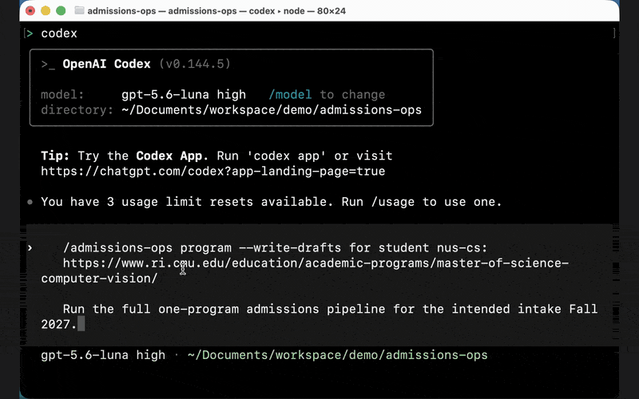
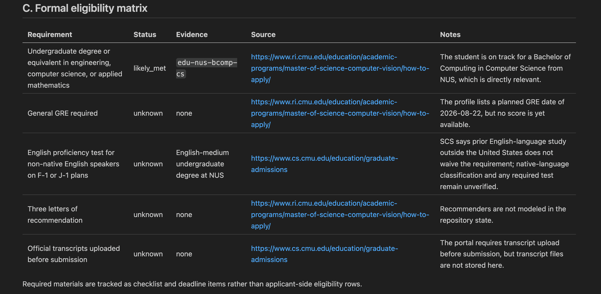
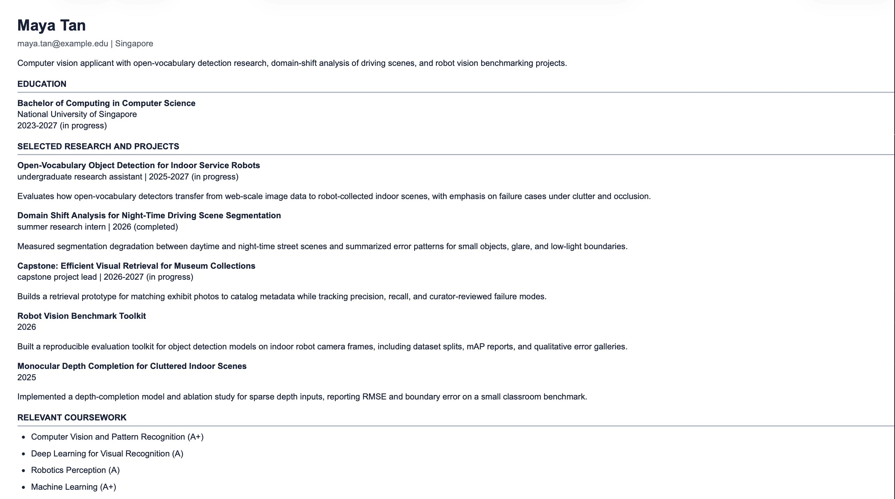

# admissions-ops

[](https://github.com/TianCZeng/admissions-ops/actions/workflows/verify.yml)
[](LICENSE)
[](CONTRIBUTING.md)

**English** | [简体中文](README.zh-CN.md)

**A graduate admissions workspace for AI agents: evaluate programs against
official pages and draft evidence-grounded academic CVs, admissions resumes,
and statements — the LLM does the judgement, deterministic code does the
guarding.** Every generated draft stays human-reviewed, and everything is
plain local files in your own private repository — no account, no server, no
telemetry. What your AI agent sends to its model provider is covered in
[Integrity & Disclaimers](#integrity--disclaimers).



<p align="center"><em><a href="docs/media/demo.mp4">▶ Watch the full-quality MP4 (~55s)</a></em></p>

<p align="center">
  
  
</p>

Give the agent one official program page and your evidence files, and one
prompt produces:

- a **sourced report** — every requirement and deadline carries its official
  URL and retrieval date;
- an **eligibility matrix** of hard gates — pass/fail requirements marked
  `met`, `likely_met`, `not_met`, `unknown`, or `not_applicable` — where
  every `unknown` becomes a verification task instead of a guess;
- a separate **fit assessment** — planning judgement, never presented as an
  admissions probability;
- a **tailored academic CV or admissions resume**, rendered only from your
  canonical evidence files — tailoring can never change dates, grades,
  authorship, titles, or publication status;
- a **statement draft** in which every nontrivial claim traces to your
  evidence or your own statement brief, marked `Review Required` until you
  review it;
- a **tracker row and per-program checklist**, so open questions do not get
  lost.

A complete worked example lives in [`students/nus-cs/`](students/nus-cs/): a
fully synthetic applicant ("Maya Tan") evaluated against a real official
program page, including the sourced report, evaluation record, rendered
resume, and statement draft.

## Why It Looks Like This

Most admissions AI is "the model writes your essay" — and it has a trust
problem. admissions-ops is built on the opposite premise: the model is good
at judgement (reading official pages, separating hard eligibility from
academic fit, choosing which of your evidence matters for this program), and
code is good at integrity (schemas, traceability, reproducibility). So the
agent authors every judgement, and deterministic validators reject anything
that does not trace back to an official source or your own evidence.
Hand-edited artifacts and hallucinated claims fail validation. Nothing is
ever marked final without human review.

## How It Keeps The Agent Honest

For agent builders: this repository is a worked example of the "LLM authors,
deterministic layer guards" architecture — agent skills plus file contracts
plus 13 deterministic validators.

- **The agent authors all judgement** — eligibility calls, fit reasoning,
  evidence selection and priorities, document type, tailored summaries,
  statement prose (`statement_plan.draft_markdown`) and its structured claim
  map (`statement_plan.claim_map`) — and records it in schema-checked YAML
  and markdown.
- **Node renders and guards; it never authors.** `npm run cv` and
  `npm run statement` serialize exactly what the agent's plan specifies. When
  a required decision is missing or malformed they fail with a preflight
  error; they never substitute a heuristic, re-rank, or paraphrase.
- **Provenance is mandatory.** Official-source facts carry URLs and retrieval
  dates; CV bullets map to evidence IDs; statement claims map to evidence,
  official sources, or the student's own brief. The packager rejects claims
  that trace to nothing.
- **Generated output is reproducible.** `verify:generated` re-renders every
  committed workspace and rejects any hand-edited artifact.
- **Review is a hard state.** Every generated artifact stays
  `Review Required`; no code path marks anything final.

The full suite is `npm run verify` (also aliased as `npm test`) — 13 targets
covering schemas, contracts, fixtures, catalog integrity, cross-artifact
consistency, and generated-output reproduction. CI runs it on every push and
pull request.

## Quickstart

1. **Clone and install** (Node.js >= 20). No GitHub account or remote is
   needed — you clone once and run everything locally. Your workspace files
   stay on your own machine, and the `.gitignore` keeps real student
   workspaces untracked by default.

   ```bash
   git clone https://github.com/TianCZeng/admissions-ops.git
   cd admissions-ops
   npm install
   npm test   # runs the 13-target deterministic verify suite
   ```

   > **Want a private cloud backup?** It's optional — cloning and running
   > locally is enough for most users. If you do want your workspace
   > versioned or backed up on GitHub, **don't fork** this repo (forks are
   > public); use **Use this template → Create a new repository → Private** to
   > make your own private copy, then clone that instead.

   **Windows note:** this repository contains committed symlinks (under
   `.claude/skills/`). Enable Windows Developer Mode and set
   `git config --global core.symlinks true` *before cloning*, or the symlinks
   check out as plain text files and agent skill discovery breaks.
2. **Open the repository in your AI agent.** In Claude Code, opening the
   repo is all it takes — the skills are picked up automatically via
   `.claude/skills/`. Any other agent that loads this repository's skills
   under `.agents/skills/` works too; the workflow is agent-led and
   local-first. **The full `program` pipeline needs an agent with live web
   access** to read real official program pages.

   Optional Codex CLI example — from the repo root:

   ```text
   codex --search
   ```

   then invoke the skill with `$admissions-ops` or select it through
   `/skills`.
3. **Prepare a student workspace** (next section), then run the one-prompt
   pipeline.

## Prepare A Student Workspace

Create or select `students/{student-id}/` with:

```text
students/{student-id}/profile.yml
students/{student-id}/preferences.yml
students/{student-id}/evidence.yml
students/{student-id}/master-cv.md
students/{student-id}/tracker.md
```

Add `students/{student-id}/statement-brief.md` when a program requires a
statement of purpose or personal statement. Use only truthful
student-authored context in the brief: narrative direction, goals,
must-include points, avoid points, program notes, and allowed personal
background.

Flat files under `students/*.example.*` show the setup shape. Files under
`examples/` are fictional fixtures for workflow development. The committed
demo workspace `students/nus-cs/` is fully synthetic — browse it to see what
one full run produces; never treat it as a real person's data.

## Full One-Program Pipeline

Use one prompt when you want the agent to run the complete one-program draft
pipeline and stop for human review at the end:

```text
$admissions-ops program for student <student-id>:
<official university or department program URL>

Run the full one-program admissions pipeline for the intended intake
<term/year>.
```

Add `--write-drafts` when you want the agent to run the dry-runs, inspect
them, and then write `Review Required` CV/resume and statement draft
artifacts back to the selected student workspace in the same pipeline:

```text
$admissions-ops program --write-drafts for student <student-id>:
<official university or department program URL>

Run the full one-program admissions pipeline for the intended intake
<term/year>.
```

For example:

```text
$admissions-ops program --write-drafts for student nus-cs:
https://www.ri.cmu.edu/education/academic-programs/master-of-science-computer-vision/

Run the full one-program admissions pipeline for the intended intake Fall 2027.
```

## What The Pipeline Does

The agent-led `program` workflow:

1. reads the selected `students/{student-id}/` workspace;
2. retrieves and cites official sources for the selected program only;
3. writes or updates shared catalog facts in `programs/catalog/`;
4. writes or updates the student-scoped evaluation, report, checklist, and
   tracker row;
5. creates or revises the CV/resume adaptation plan from `evidence.yml` and
   `master-cv.md`;
6. when official instructions require a statement and `statement-brief.md`
   exists, creates or revises `statement_plan`, including body-only
   LLM-authored `draft_markdown` and a structured `claim_map`;
7. runs the deterministic CV/resume dry-run:

   ```text
   npm run cv -- --student <student-id> --program <program-id>
   ```

8. when statement prerequisites exist, runs the deterministic statement
   packager/validator dry-run:

   ```text
   npm run statement -- --student <student-id> --program <program-id>
   ```

9. inspects dry-run outputs, links, evidence maps, word/page counts, and
   validation concerns;
10. if `--write-drafts` was specified and dry-runs succeeded without
    blockers, reruns the applicable deterministic commands with `--write`;
11. returns one final review bundle with official sources, eligibility, fit,
    generated paths, unresolved questions, and review tasks.

`--write-drafts` is approval only for post-dry-run draft writes. It is not
approval to mutate canonical student inputs, mark artifacts final, or submit
anything externally.

## Expected Outputs

After a real program evaluation, student-specific files live under the
selected student workspace:

```text
students/{student-id}/evaluations/{program-id}.yml
students/{student-id}/reports/{###}-{institution-slug}-{YYYY-MM-DD}.md
students/{student-id}/checklists/{program-id-or-slug}.md
students/{student-id}/tracker.md
students/{student-id}/output/{program-id}/adaptation-plan.md
students/{student-id}/output/{program-id}/admissions-resume.html
students/{student-id}/output/{program-id}/change-log.md
students/{student-id}/output/{program-id}/evidence-map.yml
students/{student-id}/output/{program-id}/statement-plan.md
students/{student-id}/output/{program-id}/statement-draft.md
students/{student-id}/output/{program-id}/statement-evidence-map.yml
students/{student-id}/output/{program-id}/statement-change-log.md
```

Statement output exists only when official instructions require a statement
and the selected student workspace has `statement-brief.md`. Exactly one CV
artifact (academic CV or admissions resume) exists per program, matching the
plan's `document_type`.

Shared official-source facts live separately:

```text
programs/catalog/{program-id}.yml
```

Catalog records store reusable program facts only: identity, URLs, retrieval
dates, deadlines, document instructions, source notes, freshness warnings,
and conflicts. Student-specific eligibility, fit, evidence references, CV
plans, statement plans, tracker state, reports, checklists, and output stay
under `students/{student-id}/`.

## Catalog Records Are Dated Snapshots

The committed records under `programs/catalog/` are worked examples with
retrieval dates, not a maintained deadline database. Official pages change;
a record retrieved months ago may not describe the next intake. The workflow
treats them accordingly: every record stores `retrieved_at`, the full
pipeline re-verifies against the live official page and refreshes the
record, and an evaluation that relies on an older snapshot must carry a
`catalog_freshness` note that cites the older date and explains it. Always
confirm deadlines on the official page before acting.

## Direct Deterministic Commands

Use these commands when a normalized student evaluation already exists and
you want to rerun packaging or validation directly.

CV/resume dry-run:

```text
npm run cv -- --student <student-id> --program <program-id>
```

Statement dry-run:

```text
npm run statement -- --student <student-id> --program <program-id>
```

Approved draft writes after review:

```text
npm run cv -- --student <student-id> --program <program-id> --write
npm run statement -- --student <student-id> --program <program-id> --write
```

The direct commands do not perform admissions reasoning. `npm run cv` renders
and validates the existing `cv_adaptation_plan`; `npm run statement` packages
and validates the existing `statement_plan.draft_markdown` and `claim_map`.

Dry-runs write under:

```text
validation-output/dry-run/live/{student-id}/{program-id}/
validation-output/dry-run/statement/{student-id}/{program-id}/
```

Approved writes may update only `Review Required` draft artifacts under
`students/{student-id}/output/{program-id}/` plus the matching report/tracker
links.

## Other Skill Modes

The full `program` pipeline runs both CV/resume rendering and statement
packaging when prerequisites exist, so you normally do not invoke `cv` or
`statement` directly. The modes below are for standalone refinement of one
artifact after a program has already been evaluated, plus the inbox, compare,
and tracker helpers:

```text
$admissions-ops inbox              Inspect curated entries in programs/inbox.yml
$admissions-ops compare            Compare evaluated programs only
$admissions-ops tracker            Inspect tracker and checklist state
$admissions-ops cv                 Refine a CV/resume adaptation plan for an evaluated program
$admissions-ops statement          Refine a statement plan and draft for an evaluated program
```

Use comparison only after two or more normalized student evaluation records
exist:

```text
npm run compare -- --student <student-id> --program <program-id> --program <program-id>
```

Comparison reads only the selected student's evaluations, preferences,
tracker, reports, and output, merging shared catalog facts when referenced.
Dry-runs write under `validation-output/dry-run/compare/{student-id}/`.

## Evidence Rules

- Official university or department pages are the proof source for deadlines,
  requirements, eligibility, and document instructions.
- Third-party pages may suggest leads, but they must not prove eligibility or
  deadlines.
- Unknown requirements create manual verification tasks.
- Tailored documents may select, reorder, or condense evidence, but must
  never change dates, grades, authorship, titles, publication status, or
  substantive meaning.
- Generated artifacts remain `Review Required` until human review.

## Integrity & Disclaimers

- **No affiliation.** This project is not affiliated with or endorsed by any
  university, department, or application portal. Requirements and deadlines
  change — always verify them on the official program page before acting.
  The workflow is built for exactly that: every requirement it records
  carries a source URL and retrieval date so you can re-check it.
- **Your data and the model provider.** admissions-ops keeps your files in your
  own local repository and adds no account, hosted service, or telemetry of its
  own. But it runs *inside* an AI agent (for example Claude Code), and that
  agent sends the content it works on — your evidence, CV bullets, statement
  text, and the official pages it fetches — to whatever model provider it is
  configured to use. That provider's privacy, logging, and retention terms
  govern that content, so review them. See [`SECURITY.md`](SECURITY.md) before
  putting applicant data anywhere public, such as a GitHub issue or PR.
- **AI-assisted essays.** Some programs prohibit or restrict AI-written
  application essays — check each program's policy before using statement
  drafts. This repository's own policy is deliberately conservative:
  statement drafts are grounded in your evidence and your own statement
  brief; motivation, hardship, identity, personal background, supervisors,
  courses, career goals, and program reasons are never invented; the
  packager rejects claims that trace to nothing; and every draft stays
  `Review Required` until a human reviews it. Treat drafts as a structured
  starting point to rewrite in your own voice, not a submission.
- **Synthetic demo data.** The demo applicant ("Maya Tan" under
  `students/nus-cs/`) and all fixtures under `examples/` are fully synthetic.
  No real student data is included in this repository.
- **No admissions predictions.** Eligibility is a documented hard-gate
  check; fit is a separate planning judgement. Nothing in this tool
  estimates your probability of admission.

## Repository Shape

```text
.agents/skills/admissions-ops/  Agent command router (the main agent skill)
modes/                          Prompt modules for admissions workflows
students/                       Setup examples, demo workspace, and your private applicant workspaces
programs/                       Curated inbox examples and shared official-source catalog
templates/                      Status and document templates
examples/                       Fictional fixtures for workflow development
scripts/                        Deterministic renderers, packagers, and validators
reports/, output/               Empty placeholders kept for layout; live artifacts are student-scoped
validation-output/              Gitignored dry-run and validation artifacts
```

## Status & Roadmap

The hardened core is the single-program loop: sourced evaluation, CV/resume
rendering, statement packaging, and the 13-target verify suite. Batch
evaluation queues, a tracker dashboard, and program discovery are planned but
deliberately sequenced after the core loop; planned work is tracked through
GitHub issues.

## Origins

admissions-ops is inspired by the local-first, plain-file workflow patterns of
[career-ops](https://github.com/santifer/career-ops). The admissions version
deliberately adapts those ideas to a different domain: official-source
graduate program evaluation, eligibility/fit separation, and evidence-grounded
CV, resume, and statement drafting.

## Contributing

`npm run verify` must pass, committed student content must stay fictional,
and changes that weaken the integrity invariants will not be merged — see
[CONTRIBUTING.md](CONTRIBUTING.md). Note that some documentation phrases are
asserted by `scripts/verify/layout.js` as policy guards, so doc changes may
require updating those assertions in the same PR.

## License

[MIT](LICENSE)
