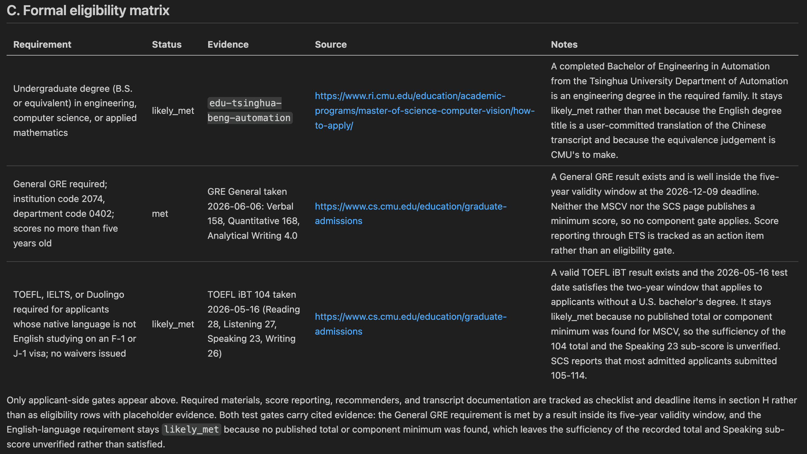
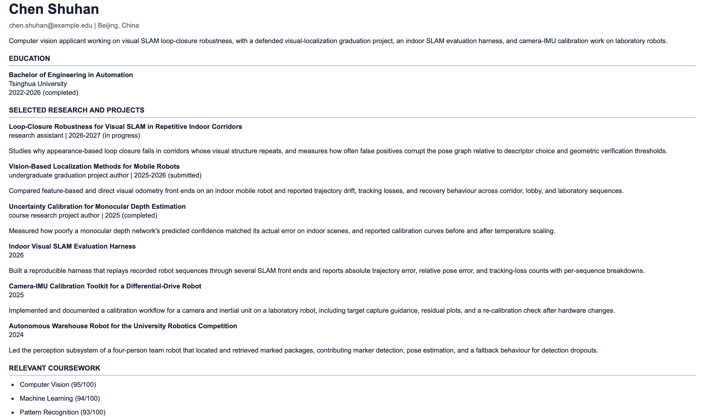
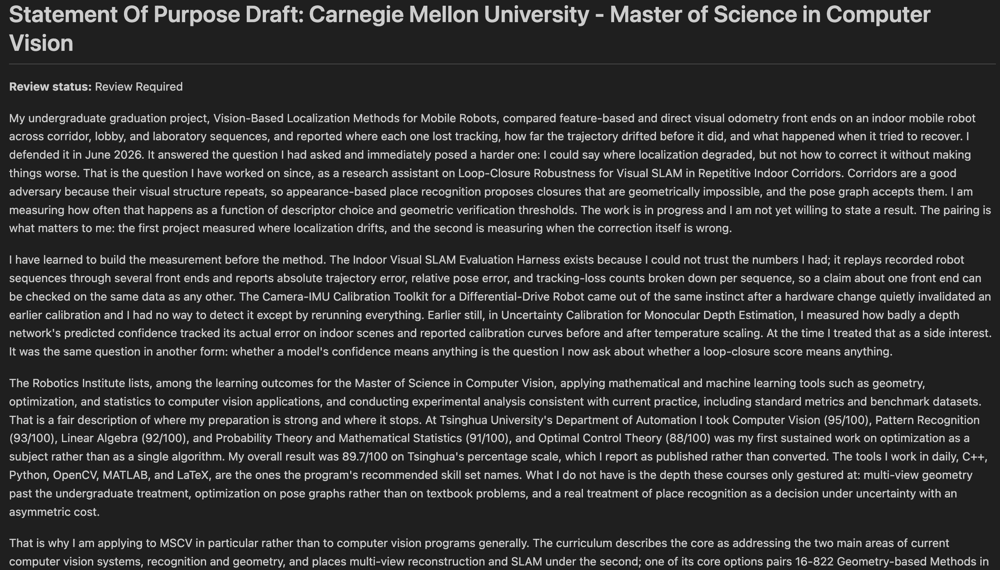

# admissions-ops

[](https://github.com/TianCZeng/admissions-ops/actions/workflows/verify.yml) [](LICENSE) [](CONTRIBUTING.md)

[English](README.md) | **简体中文**


**一个面向 AI 智能体的研究生申请工作区。给它一个项目的官方页面和你的 CV：它会对照该页面核对你的申请资格与契合度，然后起草定制的学术 CV 或申请简历；项目要求文书时，再起草一份文书。** 每条要求都注明官方出处；每份草稿只用你自己的证据生成，并保留人工审核环节。一切都是你自己电脑上的本地纯文本文件——不设账号、服务器或遥测。你的 AI 智能体会向其模型供应商发送哪些内容，详见 [诚信与免责声明](#诚信与免责声明)。

> [!TIP]
> **不会用 GitHub 或终端？把链接交给 AI 就行。** 把下面这段话发给任意 AI 助手（ChatGPT / Claude / DeepSeek / 豆包…），它会在你自己的电脑上一步步带你完成[快速开始](#快速开始)：
>
> ```text
> 我想用这个工具：https://github.com/TianCZeng/admissions-ops
> 请先读它 README 里的快速开始（Quickstart），再一步步教我装好并开始第一次使用。
> ```
>
> 之后哪一步卡住了，或者看到看不懂的报错，直接粘贴到同一个对话里问它。


<p align="center"><em><a href="docs/media/demo.zh-CN.mp4">▶ 观看完整高清 MP4（约 66 秒）</a></em></p>

<p align="center">
  
  
  
</p>

给智能体一个官方项目页面和你的证据文件，一条指令即可产出：

- 一份**有出处的报告**——每条要求和截止日期都附带官方 URL 及检索日期；
- 一张**硬性资格矩阵**——逐项判定“通过/不通过”的准入要求，标记为 `met`、 `likely_met`、`not_met`、`unknown` 或 `not_applicable`——每个 `unknown` 都会生成一条核实任务，而不是拍脑袋猜测；
- 一份独立的**契合度评估**——它属于规划层面的判断，绝不会被包装成录取概率；
- 一份**定制的学术 CV 或申请简历**，只从你的规范证据文件渲染——定制过程绝不允许改动日期、成绩、作者署名、头衔或发表状态；
- 一份**文书草稿**，其中每条实质性陈述都能追溯到你的证据文件或你本人撰写的文书简报，并保持 `Review Required` 状态直到你亲自审阅；
- 一行**追踪表记录**，外加**每个项目的清单**，确保未决问题不会被遗漏。

一个完整的示例见 [`students/tsinghua-automation/`](students/tsinghua-automation/)：完全虚构的申请人「陈书涵」，清华自动化本科、百分制成绩单，针对真实的 CMU MSCV 官方页面完成评估——这也是上面演示视频里那一次运行的产物，包含有出处的报告、评估记录、渲染出的简历和文书草稿。另一个例子见 [`students/nus-cs/`](students/nus-cs/)：同样完全虚构的申请人「Maya Tan」，英文成绩单、NUS 5.00 制 CAP。

## 快速开始

你需要 Node.js 20 或更高版本、Git，以及 Claude Code 或 Codex 等智能体。无需 GitHub 账号。第一次接触这些？把[页首提示](#admissions-ops)里的那段话发给任意 AI 助手。

<details>
<summary><strong>Windows 用户</strong>请在克隆前阅读。</summary>

本仓库包含已提交的符号链接（位于 `.claude/skills/` 下）。请在克隆*之前*启用 Windows 开发者模式并设置 `git config --global core.symlinks true`，否则符号链接会被检出为普通文本文件，智能体技能发现会失效。

</details>

1. **克隆并安装。** 工作区只保存在你自己的电脑上，`.gitignore` 默认不把它纳入 git。

   ```bash
   git clone https://github.com/TianCZeng/admissions-ops.git
   cd admissions-ops
   npm install
   ```

2. **在 `admissions-ops` 文件夹里启动 Claude Code 或 Codex**，或任何能加载 `.agents/skills/` 的智能体。要在这个文件夹里启动，而不是它的上级文件夹：智能体从它启动的文件夹加载本仓库的技能。工作流由智能体主导，完整运行需要实时网页访问。可选的 Codex CLI 示例：在该文件夹中运行 `codex --search`。
3. **把你的 CV 或成绩单放进 `students/<student-id>/raw/`**，然后运行 `setup`； `<student-id>` 是你自己取的简短 ID，例如 `chen-shuhan`。它会和你一起建好工作区，`npm run check` 通过后，给出已填好学生 ID 的 `program` 指令：

   ```text
   $admissions-ops setup for student <student-id>
   ```

   ```text
   $admissions-ops program for student <student-id>:
   <official university or department program URL>

   Run the full one-program admissions pipeline for the intended intake <term/year>.
   ```

完整运行一次约需 7 到 20 分钟的智能体时间。

<details>
<summary><strong>在 GitHub 上私有备份</strong>（可选）</summary>

在本地运行就足够了。如果想要备份，请**不要 fork** 本仓库，因为 fork 是公开的。请使用 **Use this template → Create a new repository → Private**，克隆你的副本，并在它的 `.gitignore` 里加一行：

```gitignore
!/students/<student-id>/
```

没有这一行，副本会备份除你的工作区以外的一切，因为 `.gitignore` 忽略了 `/students/*`。加上之后，工作区里的 `raw/`、`transcripts/` 等文档文件夹仍然被忽略。模板副本收不到本仓库之后的更新。

</details>

<details>
<summary><strong>改为手动配置</strong></summary>

`npm run init -- --student <student-id>` 会把示例输入复制到 `students/<student-id>/`。把内容换成你自己的，然后运行 `npm run check -- --student <student-id>`，直到通过。 [准备学生工作区](#准备学生工作区)一节说明了每个文件。

</details>

## 准备学生工作区

创建或选择 `students/{student-id}/`，包含：

```text
students/{student-id}/profile.yml
students/{student-id}/preferences.yml
students/{student-id}/evidence.yml
students/{student-id}/master-cv.md
students/{student-id}/tracker.md
```

当项目要求目的陈述（SOP）或个人陈述时，添加 `students/{student-id}/statement-brief.md`。简报中只写真实的、由学生本人提供的背景：叙事方向、目标、必须包含的要点、需要回避的要点、项目备注，以及允许使用的个人背景。

`students/*.example.*` 平铺文件展示了配置的格式。`examples/` 下是用于工作流开发的虚构 fixture。两个已提交的演示工作区 `students/tsinghua-automation/`（中文对话、百分制成绩）和 `students/nus-cs/` 都完全是虚构的——可以浏览它们了解一次完整运行的产出；切勿把它们当作真实个人数据。

## 完整的单项目流水线

当你希望智能体完整跑一遍单项目草稿流水线、并在最后停下来等待人工审核时，用一条指令：

```text
$admissions-ops program for student <student-id>:
<official university or department program URL>

Run the full one-program admissions pipeline for the intended intake
<term/year>.
```

如果希望智能体先做试运行（dry-run）、检查结果，然后在同一条流水线中把 `Review Required` 状态的 CV/简历与文书草稿写回所选学生工作区，则加上 `--write-drafts`：

```text
$admissions-ops program --write-drafts for student <student-id>:
<official university or department program URL>

Run the full one-program admissions pipeline for the intended intake
<term/year>.
```

例如——这就是演示视频里输入的那一条指令，一字未改：

```text
/admissions-ops program --write-drafts 学生 tsinghua-automation:
你好，我要申请 2027 年秋季入学，请把下面这个项目从头到尾跑完：
https://www.ri.cmu.edu/education/academic-programs/master-of-science-computer-vision/

我要评估报告、改好的申请简历和文书草稿；还差哪些没核实的信息，一并列出来。
```

参数部分照旧：`program` 必须排在最前（路由按这一行匹配），`--write-drafts` 是写入授权，学生 id 原样保留；只有 `for student` 换成了中文的「学生」。指令用中文说的是范围和交付物，而不是要求“给出处”“别换算成绩”“保持 Review Required”——那些是产品本身的承诺，不需要你在指令里讨。

## 流水线做什么

智能体主导的 `program` 工作流会：

1. 读取所选的 `students/{student-id}/` 工作区；
2. 只针对所选项目检索并引用官方来源；
3. 写入或更新 `programs/catalog/` 中的共享目录事实；
4. 写入或更新学生范围内的评估记录、报告、清单和追踪表记录；
5. 基于 `evidence.yml` 和 `master-cv.md` 创建或修订 CV/简历适配计划；
6. 当官方要求文书且 `statement-brief.md` 存在时，创建或修订 `statement_plan`，包括由 LLM 撰写的正文 `draft_markdown` 和结构化的 `claim_map`；
7. 运行确定性的 CV/简历试运行：

   ```text
   npm run cv -- --student <student-id> --program <program-id>
   ```

8. 当文书前置条件满足时，运行确定性的文书打包/校验（statement packager/validator）试运行：

   ```text
   npm run statement -- --student <student-id> --program <program-id>
   ```

9. 检查试运行产物、链接、证据映射、字数/页数和校验告警；
10. 如果指定了 `--write-drafts` 且试运行无阻塞问题，则用 `--write` 重跑相应的确定性命令；
11. 返回一份最终审核包：官方来源、资格判定、契合度、生成文件路径、未决问题和审核任务。

`--write-drafts` 仅授权在试运行之后写入草稿。它不授权改动学生的规范输入文件、把产物标记为最终版，或向外部提交任何内容。

## 预期产出

完成一次真实项目评估后，学生相关文件位于所选学生工作区内：

```text
students/{student-id}/evaluations/{program-id}.yml
students/{student-id}/reports/{###}-{institution-slug}-{YYYY-MM-DD}.md
students/{student-id}/checklists/{program-id-or-slug}.md
students/{student-id}/tracker.md
students/{student-id}/output/{program-id}/adaptation-plan.md
students/{student-id}/output/{program-id}/admissions-resume.html
students/{student-id}/output/{program-id}/change-log.md
students/{student-id}/output/{program-id}/evidence-map.yml
students/{student-id}/output/{program-id}/statement-plan.md
students/{student-id}/output/{program-id}/statement-draft.md
students/{student-id}/output/{program-id}/statement-evidence-map.yml
students/{student-id}/output/{program-id}/statement-change-log.md
```

只有当官方要求文书且所选学生工作区存在 `statement-brief.md` 时才会有文书产出。每个项目恰好存在一个 CV 产物（学术 CV 或申请简历），与计划中的 `document_type` 一致。

共享的官方来源事实单独存放：

```text
programs/catalog/{program-id}.yml
```

目录记录只存放可复用的项目事实：项目标识、URL、检索日期、截止日期、文档要求、来源备注、时效性警告和页面冲突。学生相关的资格判定、契合度、证据引用、CV 计划、文书计划、追踪状态、报告、清单和产出全部保留在 `students/{student-id}/` 下。

## 目录记录是带日期的快照

`programs/catalog/` 下已提交的记录是*附带检索日期的示例*，不是持续维护的截止日期数据库（not a maintained deadline database）。官方页面会变化；数月前检索的记录未必适用于下一个入学季。工作流对此有明确处理：每条记录都存有 `retrieved_at`，完整流水线会对照官方页面实时核对并刷新记录；依赖较旧快照的评估必须附带 `catalog_freshness` 说明，引用旧日期并解释原因。行动之前务必在官方页面上确认截止日期。

## 直接运行确定性命令

当规范化的学生评估记录已存在、你想直接重跑打包或校验时，使用以下命令。

CV/简历试运行：

```text
npm run cv -- --student <student-id> --program <program-id>
```

文书试运行：

```text
npm run statement -- --student <student-id> --program <program-id>
```

审核通过后的草稿写入：

```text
npm run cv -- --student <student-id> --program <program-id> --write
npm run statement -- --student <student-id> --program <program-id> --write
```

直接命令不做任何申请判断。`npm run cv` 渲染并校验已有的 `cv_adaptation_plan`；`npm run statement` 打包并校验已有的 `statement_plan.draft_markdown` 和 `claim_map`。

试运行写入：

```text
validation-output/dry-run/live/{student-id}/{program-id}/
validation-output/dry-run/statement/{student-id}/{program-id}/
```

审核通过的写入只能更新 `students/{student-id}/output/{program-id}/` 下处于 `Review Required` 状态的草稿产物，以及对应的报告/追踪表链接。

## 其他技能模式

完整的 `program` 流水线会在前置条件满足时同时运行 CV/简历渲染和文书打包，所以通常不需要单独调用 `cv` 或 `statement`。下面这些模式用于对已评估项目的单个产物做独立打磨，以及 inbox、compare、tracker 辅助功能：

```text
$admissions-ops inbox              查看 programs/inbox.yml 中人工筛选的条目
$admissions-ops compare            仅对比已评估的项目
$admissions-ops tracker            查看追踪表和清单状态
$admissions-ops cv                 为已评估项目打磨 CV/简历适配计划
$admissions-ops statement          为已评估项目打磨文书计划和草稿
```

只有当已存在两条以上规范化学生评估记录时才使用对比：

```text
npm run compare -- --student <student-id> --program <program-id> --program <program-id>
```

对比只读取所选学生的评估、偏好、追踪表、报告和产出，并在被引用时合并共享目录事实。试运行写入 `validation-output/dry-run/compare/{student-id}/`。

## 证据规则

- 大学或院系官方页面是截止日期、要求、资格和文档要求的唯一证明来源。
- 第三方页面可以提供线索，但绝不能作为资格或截止日期的证明。
- 未知的要求会生成人工核实任务。
- 定制文档可以选择、重排或精简证据，但绝不能改动日期、成绩、作者署名、头衔、发表状态或实质含义。
- 生成产物在人工审核之前始终保持 `Review Required`。

## 诚信与免责声明

- **无关联声明。** 本项目与任何大学、院系或申请系统均无关联，也未获其背书。要求和截止日期会变化——行动之前务必在官方项目页面上核实。工作流正是为此而设计：它记录的每条要求都附带来源 URL 和检索日期，方便你随时复查。
- **你的数据与模型供应商。** admissions-ops 把你的文件保留在你自己的本地仓库中，自身不设账号、托管服务或遥测。但它运行在 AI 智能体（例如 Claude Code）之中，该智能体会把它处理的内容——你的证据、CV 条目、文书文本，以及它抓取的官方页面——发送给它所配置的模型供应商。这些内容受该供应商的隐私、日志与数据留存条款约束，请务必查阅。在把任何申请人数据放到公开位置（如 GitHub issue 或 PR）之前，请先阅读 [`SECURITY.md`](SECURITY.md)。
- **AI 辅助文书。** 部分项目禁止或限制 AI 撰写的申请文书——使用文书草稿之前，请先查阅每个项目的相关政策。本仓库自身的政策刻意保守：文书草稿以你的证据和你本人撰写的文书简报为根基；动机、困难经历、身份、个人背景、导师、课程、职业目标和选校理由绝不虚构；打包器会拒绝任何无出处的陈述；每份草稿都保持 `Review Required` 直到人工审阅。请把草稿当作供你用自己的声音重写的结构化起点，而不是可直接提交的成品。
- **虚构演示数据。** 两位演示申请人（`students/tsinghua-automation/` 下的「陈书涵」和 `students/nus-cs/` 下的 “Maya Tan”）以及 `examples/` 下的所有 fixture 均为完全虚构。本仓库不包含任何真实学生数据。
- **语言。** 你可以用任何语言与智能体对话。但它写出的一切都是英文——报告、清单、跟踪表单元格、CV/简历正文、文书草稿，以及它们背后的证据记录——因为这些文件要提交给的项目本身要求英文。这一点没有配置项。带变音符号的拉丁字母（`Saarbrücken`、`Kovač`）完全正常；非英文的成绩单由你和智能体在对话中一起翻译，译出的专有名词会作为待核实事项记录，而不是被当成既定事实写死。
- **不做录取预测。** 资格判定是有据可查的硬性核对；契合度则是独立的规划性判断。本工具中没有任何功能会估算你的录取概率。

## 为什么是这样的设计

大多数申请类 AI 是“让模型替你写文书”——而这正是信任问题所在。admissions-ops 建立在相反的前提之上：模型擅长判断（阅读官方页面、区分硬性资格与学术契合、挑选哪些证据与该项目相关），代码擅长诚信（模式校验、可追溯性、可复现性）。因此所有判断由智能体作出，而确定性校验器会拒绝任何无法追溯到官方来源或你自身证据的内容。手工改动的产物和凭空捏造的陈述都会导致校验失败。任何内容都不会未经人工审核就被标记为最终版。

## 如何让智能体保持诚实

写给智能体开发者：这个仓库是“LLM 负责创作，确定性层负责把关”架构的一个完整实例——智能体技能 + 文件契约 + 13 个确定性校验器。

- **所有判断由智能体作出**——资格判定、契合度推理、证据选择与优先级、文档类型、定制摘要、文书正文（`statement_plan.draft_markdown`）及其结构化陈述映射（`statement_plan.claim_map`）——并记录在受模式校验的 YAML 与 Markdown 文件中。
- **Node 只做渲染和把关，从不创作。** `npm run cv` 和 `npm run statement` 严格按智能体计划的内容序列化输出。当必需的决策缺失或格式错误时，它们以预检错误直接失败；绝不擅自用启发式规则代替、重新排序或改写内容。
- **出处是强制的。** 官方来源事实附带 URL 与检索日期；CV 条目映射到证据 ID；文书陈述映射到证据、官方来源或学生本人的简报。打包器会拒绝任何无出处的陈述。
- **生成产物可复现。** `verify:generated` 会重新渲染每一个已提交的工作区，并拒绝任何手工改动过的产物。
- **审核是一个硬状态。** 所有生成产物都保持 `Review Required`；没有任何代码路径会把它们标记为最终版。

完整校验套件是 `npm run verify`（也可用 `npm test` 触发）——共 13 个目标，覆盖模式、契约、fixture、目录完整性、跨产物一致性和生成产物复现。CI 会在每次 push 和 pull request 上运行它。

## 仓库结构

```text
.agents/skills/admissions-ops/  智能体命令路由（主智能体技能）
modes/                          申请工作流的提示词模块
students/                       配置示例、演示工作区，以及你的私有申请人工作区
programs/                       人工筛选的 inbox 示例和共享官方来源目录
templates/                      状态和文档模板
examples/                       用于工作流开发的虚构 fixture
scripts/                        确定性渲染器、打包器和校验器
reports/, output/               仅为保持目录结构的空占位；实际产物按学生范围存放
validation-output/              被 gitignore 的试运行与校验产物
```

## 现状与路线图

久经打磨的核心是单项目闭环：有出处的评估、CV/简历渲染、文书打包，以及 13 个目标的校验套件。批量评估队列、追踪面板和项目发现已在计划中，但刻意排在核心闭环之后；计划中的工作通过 GitHub issues 追踪。

## 起源

admissions-ops 受到 [career-ops](https://github.com/santifer/career-ops) 中本地优先、纯文件工作流模式的启发。这个学业申请仓库刻意将这些思路适配到不同领域：基于官方来源的研究生项目评估、资格与契合度分离，以及以证据为根基的 CV、申请简历和文书草稿。

## 参与贡献

`npm run verify` 必须通过，提交的学生内容必须保持虚构，削弱诚信不变式的改动不会被合并——详见 [CONTRIBUTING.md](CONTRIBUTING.md)。注意：部分文档措辞由 `scripts/verify/layout.js` 作为政策守卫断言，因此文档改动可能需要在同一个 PR 中同步更新这些断言。

## 许可证

[MIT](LICENSE)
